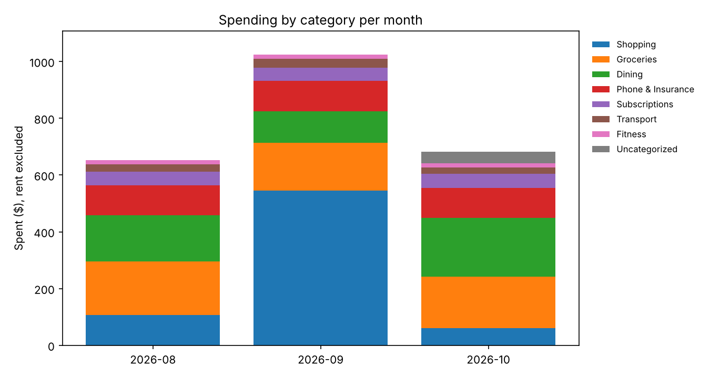

# Personal Finance Agent

Upload a bank export (CSV) and ask questions about your money in plain English:

- "What subscriptions do I have?"
- "Was I charged twice anywhere?"
- "Am I on track with my budget?"
- "What were my biggest purchases?"

Behind the scenes it runs a small set of analysis tools, and an agent picks the right one for each question:

| Tool | What it does |
|---|---|
| `spending_by_category` | Totals per category, for all time or one month |
| `find_subscriptions` | Charges that repeat roughly monthly at a steady price; splits real subscriptions from bills and flags price increases |
| `budget_check` | Compares spending to the 50/30/20 rule (needs / wants / savings) |
| `find_anomalies` | Possible duplicate charges, and purchases far above normal for their category |
| `biggest_purchases` | Largest one-off purchases (rent and recurring bills left out) |
| `monthly_summary` | Income, spending and savings per month |

## Run it

```bash
python agent.py bank_export.csv --report   # full report + spending.png chart
python agent.py bank_export.csv            # chat in the terminal
python -m pytest -q                                # 10 tests
```

**AI mode (optional):** `pip install anthropic`, set `ANTHROPIC_API_KEY`, add `--ai`. Claude then uses **tool use**: it decides which tools to call, the tools run on your computer, and it writes the answer. Only tool results (totals, merchant names) go to the model, never the raw CSV. In demo mode nothing leaves your computer.

On the sample data it finds 4 subscriptions (~$780/year) including a Netflix price increase, a duplicate $12.85 charge, and a $490 purchase about 10x the normal for that category.

The sample bank export is **fictional**, generated by a seeded script for this demo.

## What broke and how I fixed it

- **Bills showed up as subscriptions.** Car insurance and a phone plan repeat monthly, so they matched the subscription rule. They're real bills, not something you'd cancel on a whim, so they're now listed separately.
- **"Biggest purchases" was mostly the same bill.** The insurance payment showed up three times in the top five. Recurring charges are now excluded so the list shows real one-off purchases.
- **The outlier check hid the outlier.** Including the $490 purchase in its own category's average made it look less unusual. Each purchase is now compared to the *rest* of its category.
- **Same store, different numbers.** "CHIPOTLE 1123" and "CHIPOTLE 2210" should be one merchant, so store numbers and symbols are stripped before grouping.

Not financial advice. Built with AI help (Claude) for writing and debugging the code.


